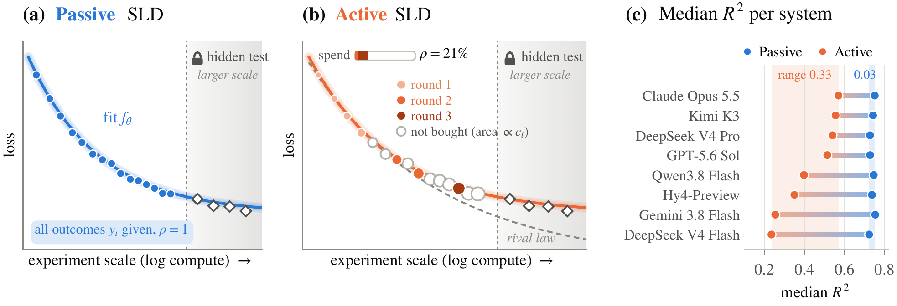
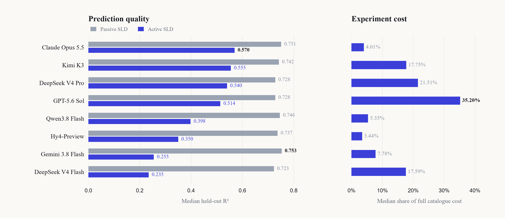

<div align="center">

<h1>SLDBench v2</h1>
<h3>Active Scaling Law Discovery</h3>

[Website](https://lingbei-meng.github.io/SLDBench-v2/) &nbsp; | &nbsp; [Paper](https://arxiv.org/abs/2610.16297) &nbsp; | &nbsp; [Results](#2-evaluation-results) &nbsp; | &nbsp; [Datasets](#3-datasets) &nbsp; | &nbsp; [Quick Start](#4-quick-start) &nbsp; | &nbsp; [Citation](#citation)

**127 datasets** &nbsp; · &nbsp; **3,376,938 prediction records** &nbsp; · &nbsp; **30 evaluation tasks**

</div>

## 1. Introduction

**SLDBench v2 evaluates whether AI agents can discover scaling laws while deciding which experiments are worth their cost.** It couples open-ended law discovery with sequential experiment selection: agents choose measurements, observe outcomes, refine their laws, and decide when to stop. Historical experiment replay brings the decisions behind large-scale model development into an efficient, repeatable benchmark.

<p align="center"></p>

**Passive SLD** supplies all training observations upfront. **Active SLD** exposes a priced catalogue and reveals the outcomes of purchased experiments. Both settings test extrapolation to the same held-out experiments. The figure is reproduced from Figure 1 of the paper.

## 2. Evaluation results

**30 tasks · 3 repeats per setting · quality and experiment cost evaluated together.**

<p align="center"></p>

**Prediction quality.** Passive median R² values cluster between **0.723 and 0.753**, while Active medians range from **0.235 to 0.570**. Requiring agents to acquire their own observations reveals substantial differences in experimental decision-making.

**Experiment cost.** The four highest Active medians range from **0.514 to 0.570**, at median acquisition costs of **4.01–35.20%** of the full catalogue. Quality and cost are shown separately so that both can be compared directly.

**Experimental coverage.** Agents favor inexpensive measurements. Their purchases must also cover the conditions and scales needed for extrapolation: observing a group only at its cheapest configurations can leave its scaling behavior unresolved.

| Model | Harness | Passive R² | Active R² | Gap | Mean cost | Median cost |
|:---|:---|---:|---:|---:|---:|---:|
| Claude Opus 5.5 | Claude Code | 0.751 | 0.570 | -0.181 | 7.77% | 4.01% |
| Kimi K3 | Claude Code | 0.742 | 0.555 | -0.187 | 32.00% | 17.75% |
| DeepSeek V4 Pro | Claude Code | 0.728 | 0.540 | -0.188 | 34.80% | 21.51% |
| GPT-5.6 Sol | Codex | 0.728 | 0.514 | -0.214 | 43.80% | 35.20% |
| Qwen3.8 Flash | Claude Code | 0.746 | 0.398 | -0.348 | 15.80% | 5.35% |
| Hy4-Preview | Claude Code | 0.737 | 0.350 | -0.387 | 9.10% | 3.44% |
| Gemini 3.8 Flash | Gemini CLI | 0.753 | 0.255 | -0.499 | 25.90% | 7.78% |
| DeepSeek V4 Flash | Claude Code | 0.723 | 0.235 | -0.488 | 39.30% | 17.59% |

R² columns report median held-out scores; rows are ordered by Active R². Gap is the Active median minus the Passive median. Mean and median cost are percentages of the full catalogue's experiment cost. The full-pool reference law achieves a median R² of **0.455** at **100%** cost.

The repository includes the reference fitter and four acquisition policies. See [baseline instructions](docs/BASELINES.md) for the commands, inputs and output formats.

**Best@3 R².** For each task and setting, take the highest R² among the three runs, then report the median across all 30 tasks. The table below adds best@3 alongside the run-level medians above.

| Model | Passive best@3 R² | Active best@3 R² |
|:---|---:|---:|
| Claude Opus 5.5 | 0.8179 | 0.6877 |
| Kimi K3 | 0.7684 | 0.6919 |
| DeepSeek V4 Pro | 0.7545 | 0.7583 |
| GPT-5.6 Sol | 0.7744 | 0.7438 |
| Qwen3.8 Flash | 0.7978 | 0.6673 |
| Hy4-Preview | 0.7970 | 0.5659 |
| Gemini 3.8 Flash | 0.7895 | 0.5611 |
| DeepSeek V4 Flash | 0.7494 | 0.5758 |

[Task-wise best@3 results](results/best_at_3.json)

[Result files and evaluation configurations](results/README.md)

## 3. Datasets

The collection spans language-model pretraining, downstream accuracy, vision and vision–language transfer, multilingual embeddings, optimization, tokenization, and protein language models.

| Collection | Datasets | Prediction records |
|:---|---:|---:|
| Full collection | **127** | **3,376,938** |
| Training splits | 127 | 2,694,330 |
| Held-out test splits | 127 | 682,608 |
| Evaluation subset | **30** | **339,092** |

**60 datasets support Active SLD.** Each includes a priced acquisition catalogue and its associated measurements. Task metadata specifies the original source, features, target, groups, fixed train/test splits, and cost basis. Prices follow explicit cost columns or the documented `6ND` compute proxy; acquisition charges each distinct candidate once.

[Dataset index](metadata/tasks.json) &nbsp; · &nbsp; [Evaluation tasks](metadata/evaluation_tasks.json) &nbsp; · &nbsp; [Original data sources](DATA_SOURCES.md)

## 4. Quick start

The repository includes the **complete data collection, published results, and executable evaluation code**. The runner assembles the 30 evaluation tasks in both Passive and Active settings directly from the data below.

### Load and validate the datasets

Python 3.10 or later; works on Linux, macOS, and Windows.

```bash
python -m pip install -r requirements.txt
python tools/validate.py
```

```python
from sldbench import list_tasks, load_dataset, load_metadata, load_catalogue

print(len(list_tasks()))                # 127 datasets
print(len(list_tasks(selected=True)))   # 30 evaluation tasks

task = "colpret_ibm_model_token_boolq_accuracy_scaling"
meta = load_metadata(task)
train = load_dataset(task, "train")
catalogue = load_catalogue(task)
features = meta["contract"]["features"]
target = meta["contract"]["target"]
print(train[["group", *features, target]].head())
print(catalogue.head())
```

The `group` column identifies experimental conditions. Each task's contract specifies the features, target, and prediction interface.

### Run an agent

Use **Linux x86_64, Python 3.12, Docker Engine, and Docker Compose v2**. On Windows, run these commands inside WSL2 with Docker available. No GPU is required. Run commands from the repository root.

```bash
python3.12 -m venv .venv
source .venv/bin/activate
python -m pip install -r requirements-benchmark.txt
python -m benchmark.prepare
python run.py --smoke --name first_run
```

The default uses **Qwen3.8 Flash through Claude Code** and Alibaba Cloud's Anthropic-compatible endpoint. Enter your API key at the hidden prompt, or set `DASHSCOPE_API_KEY` in your environment. API requests use your account; the smoke command runs one task in both settings. It uses a short execution configuration to check the complete pipeline.

**Claude Code, Codex and Gemini CLI** share the same evaluation entry point. Select a framework with `--agent`; each uses its native model API:

```bash
# OPENAI_API_KEY; OpenAI Responses-compatible endpoint
python run.py --agent codex --smoke --name codex_smoke

# GEMINI_API_KEY; Gemini generateContent-compatible endpoint
python run.py --agent gemini-cli --smoke --name gemini_smoke
```

Use `--model`, `--base-url` and `--api-key-env` for another compatible provider. See [Running the benchmark](docs/RUNNING.md) for pinned versions, configuration and full-run commands.

Run the full evaluation subset with three repeats per setting:

```bash
python run.py --all --setting both --repeats 3 --concurrency 2 --name qwen_full
python tools/summarize_runs.py runs/qwen_full
```

This schedules **180 trials**: 30 tasks × 2 settings × 3 repeats. Outputs go to `runs/<name>/`, including submitted laws, trajectories, held-out scores, acquisition costs, and token usage. Three-repeat runs additionally produce task-wise best@3 and its median across tasks. Published results remain in `results/`.

Inspect the setup without API calls:

```bash
python run.py --list
python run.py --all --repeats 3 --dry-run
```

[Runtime configuration and output format](docs/RUNNING.md) · [Evaluation protocol](docs/PROTOCOL.md) · [Validation](docs/VALIDATION.md) · [Known limitations](docs/KNOWN_LIMITATIONS.md)

### Run the reference law and acquisition baselines

No model API or GPU is needed. Use Python 3.12 and run from the repository root:

```bash
python -m pip install -r requirements-baselines.txt
python -m baselines.acquisition --workers 8
```

This evaluates 30 tasks with four acquisition rules and eight budget levels, using three seeds for random selection. Scores, acquisition costs and run configuration are saved under `runs/reference_baselines/`.

[Baseline methods and usage](docs/BASELINES.md)

## 5. Repository layout

```text
datasets/<task>/           # 127 datasets: train/test tables and contracts
active/<task>/             # 60 priced catalogues and evaluator-side measurements
metadata/                  # Dataset index, 30-task selection, counts and checksums
benchmark/
  run.py                   # Agent execution and per-run summaries
  prepare.py               # Assemble tasks from the canonical repository data
  runtime.py               # Harbor integration and isolated Docker environments
  task_templates/          # Task instructions, acquisition tools and verifiers
  tasks-manifest.json      # Mapping from runtime files to checksummed sources
  Dockerfile               # Portable image with pinned scientific dependencies
results/                   # Published model results, including best@3 R²
baselines/                 # Reference fitting and four acquisition policies
  reference_laws/          # 30 original reference fitters
assets/                    # Paper overview and result figures
docs/                      # Running instructions, protocol and validation
tests/                     # Offline integration and metric checks
tools/                     # Dataset validation and result aggregation
sldbench.py                # Data-loading helpers
run.py                     # Evaluation entry point
```

`benchmark/tasks/` is generated during preparation, and `runs/` contains new evaluations. Neither directory is committed. The original data appear once in the release; task environments receive verified copies of the required files. Active outcomes are accessed through the metered acquisition tool inside the agent container, while held-out evaluation runs in a separate container.

## Citation

```bibtex
@misc{meng2026sldbenchv2,
  title = {SLDBench v2: Active Scaling Law Discovery},
  author = {Lingbei Meng and Rui Huang and Zhirong Shen and Jinxin Liu and
            Lingxiao Jing and Haorui Chen and Yaosong Du and Haowei Lin},
  year = {2026},
  url = {https://arxiv.org/abs/2610.16297}
}
```

Please also cite the original sources of the tasks you use, listed in [DATA_SOURCES.md](DATA_SOURCES.md).

## License and contact

Original code and documentation are released under the [MIT License](LICENSE). Experimental data retain their original source terms.

**Equal contribution:** Lingbei Meng and Rui Huang

**Corresponding author:** Haowei Lin · [linhaowei@pku.edu.cn](mailto:linhaowei@pku.edu.cn)

## Interactive project website

The bilingual project page is available in [docs/index.html](docs/index.html). See [website publishing instructions](docs/WEBSITE.md) for GitHub Pages deployment.
